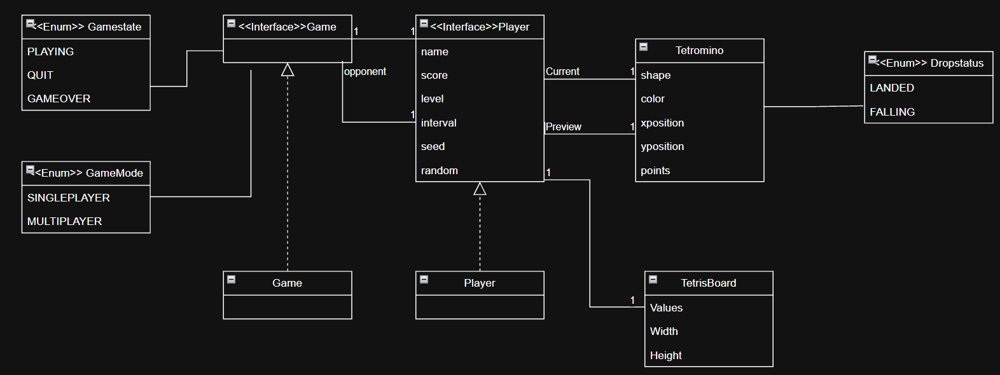
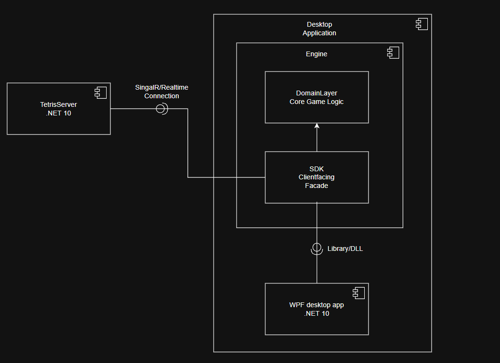

# Tetris

A simple implementation of Tetris with multiplayer support. The game is built using .NET 10.0 and C#.

## Get Started

## Installation

Simply download the [installer](https://github.com/Hmed-S/Tetris/releases/download/v0.2.0-beta/Hmed-S-Tetris-Setup-v0.2.0-beta.exe) and install the game. Click the `Help` button for instructions on how to play.

## Running the Project

### The Client

From the `./Tetris/TetrisClient` directory, run:

```bash
dotnet run
```

### The Server

Run the following commands from the `./Tetris/TetrisServer` directory.

#### With Docker

```bash
docker-compose up
```

##### Services

| Service      | URL            |
| ------------ | -------------- |
| Redis        | localhost:6379 |
| RedisInsight | localhost:5540 |
| TetrisServer | localhost:5050 |

#### Without Docker

##### Prerequisites

- Redis running on `localhost:6379`
- .NET 10.0

Run:

```bash
dotnet run
```

## Models and Quick Architectural Overview

### Domain Model

The domain model shown below provides a quick overview of the application's domain structure.

- Drop status indicates whether a tetromino has landed.
- The `Player` class holds two references to `Tetromino`: the current tetromino, which is falling, and the preview tetromino. The preview becomes the current tetromino once the current one has landed.
- The `Player` class uses the `TetrisBoard` to check whether a tetromino fits and to perform actions such as line clears. Notice that only the current tetromino and the preview tetromino are referenced.
- Neither `Player` nor `TetrisBoard` holds references to all tetrominoes in a game.
- The `Game` class is the main entity responsible for creating a game and managing its players, `GameState`, and `GameMode`.
- Most attributes shown in the model are represented by value objects in the code, following the principles of [Domain-Driven Design](https://medium.com/@uzezijephter/understanding-value-objects-in-domain-driven-design-ddd-af144c742866).



### Components

This Tetris application consists of two applications: the server and the desktop client.

The desktop client is divided into the Engine backend and the WPF frontend. The Engine consists of the Domain layer, which contains the core game logic, and a Facade layer (the SDK), which the clients depend on.

The Facade layer exposes the required data through DTOs, which emit events that clients can react to. It also handles the connection to the server, which is used exclusively for multiplayer functionality.


